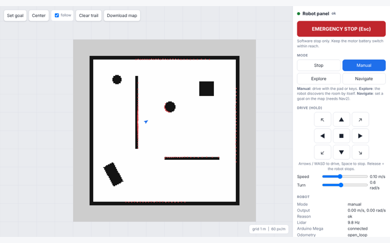
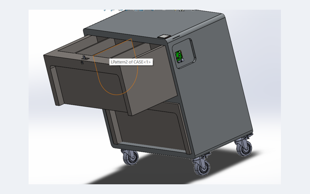
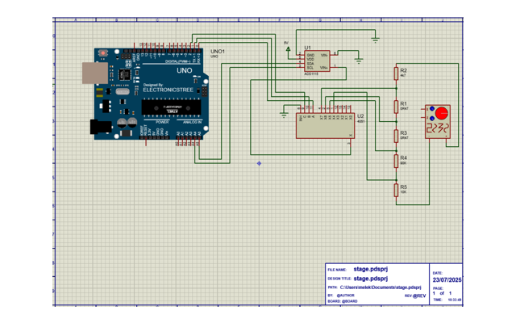
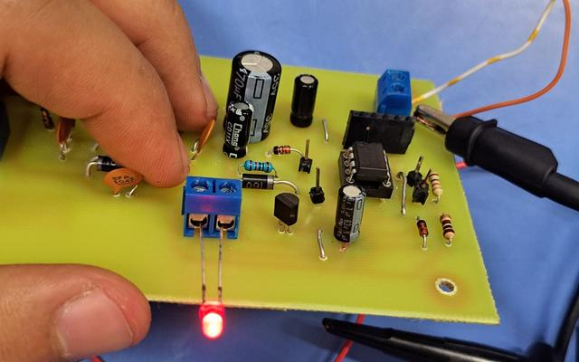
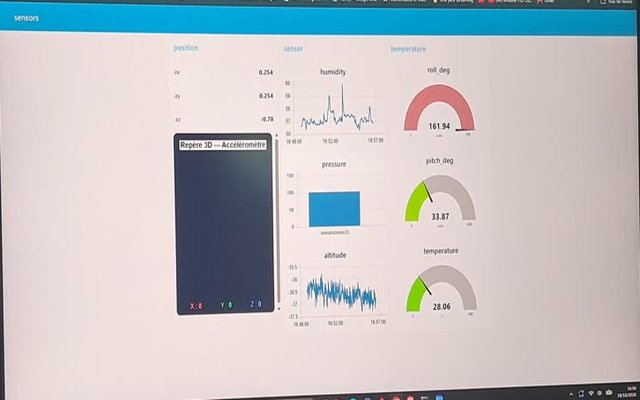

<h1 align="center">⚡ Melek Chourabi · Electrical Engineering Portfolio</h1>
<h3 align="center">Embedded systems · Robotics · Electronics · Applied AI</h3>

  
  
  
  
  
  
  

I am a final-year electrical engineering student at **ENIT** (École Nationale d'Ingénieurs de Tunis, Tunisia). I like projects where
electronics, firmware and software meet: robots, instrumentation, connected sensors and embedded vision. Each project below comes with its documentation,
and the code that can be tested without hardware has automated tests.

---

## 🚀 Projects

<table>
  <tr>
    <td width="50%" valign="top">
      
      <h3>🤖 <a href="https://github.com/melek2232/ros2-lidar-robot">ROS 2 lidar robot</a></h3>
      
Raspberry Pi 5 + Arduino Mega + YDLIDAR X2. SLAM mapping, PC web panel, autonomous exploration and a safety layer between every command and the motors.

      
ROS 2 Jazzy · slam_toolbox · Nav2 · Python · C++ · Arduino · Docker Screenshot: simulation. Tested offline; hardware validation in progress.

    </td>
    <td width="50%" valign="top">
      
      <h3>🛒 <a href="inventory-cart-rpi-yolo/README.md">Intelligent inventory cart</a></h3>
      
SolidWorks-designed cart with a Raspberry Pi verifier: camera object counting (YOLOv8 / ONNX) cross-checked in real time with barcode scans.

      
Raspberry Pi 5 · ONNX Runtime · OpenCV · Tkinter · SolidWorks · pytest

    </td>
  </tr>
  <tr>
    <td width="50%" valign="top">
      
      <h3>🔌 <a href="auto-ranging-voltmeter/README.md">Auto-ranging digital voltmeter</a></h3>
      
Arduino UNO + ADS1115 (16-bit) + CD4051 multiplexer. Automatic selection among 4 divider ratios (1:1 to 1:100), with hysteresis and over-range detection. Built during an internship at SAGEMCOM.

      
Arduino · I²C · analog front-end · Proteus

    </td>
    <td width="50%" valign="top">
      
      <h3>⚠️ <a href="cable-cut-detection-pfa/README.md">Cable cut detection system</a></h3>
      
Detects the disappearance of a 25 kHz supervision signal and raises a buzzer + LED alarm. Two architectures compared: discrete analog and PIC12F675, with a KiCad PCB.

      
KiCad · PIC12F675 · analog design · oscilloscope measurements

    </td>
  </tr>
  <tr>
    <td width="50%" valign="top">
      
      <h3>📡 <a href="ble-mqtt-sensor-monitor/README.md">Wireless sensor monitor (BLE + MQTT)</a></h3>
      
Arduino Nano 33 BLE Sense → BLE → Raspberry Pi gateway → Mosquitto → Node-RED dashboard. Motion, temperature, humidity and pressure at 1 Hz, with 70 minutes of logged data.

      
MQTT · Mosquitto · BLE · Node-RED · Python (bleak, paho) · Arduino

    </td>
    <td width="50%" valign="top"></td>
  </tr>
</table>

---

## 🛠️ Skills

| Domain | What I work with |
|---|---|
| 🤖 **Robotics** | ROS 2 (nodes, TF, launch, lifecycle), SLAM and navigation (slam_toolbox, Nav2), differential-drive kinematics, safety layers (dead-man, e-stop, obstacle stop) |
| 🔌 **Embedded / hardware** | Raspberry Pi (GPIO, camera), Arduino (I²C, PWM, serial protocols), H-bridge motor drivers, PIC12F675, ADCs and analog front-ends, digital logic (FSMs) |
| 💻 **Software** | Python (Tkinter, pyserial, pytest), C / C++ basics, computer vision (YOLOv8, ONNX Runtime), Docker, Git and CI |
| 📡 **Networks / IoT** | MQTT (Mosquitto, paho-mqtt, topics and QoS), Bluetooth Low Energy (GATT, notifications), Node-RED dashboards, JSON telemetry |
| 📐 **Design tools** | KiCad, Proteus, SolidWorks, LaTeX / TikZ, functional specifications (bête à cornes, pieuvre) |

---

## 🧭 What I am looking for

Internships and projects in **robotics, embedded systems and automation**. If one of these projects interests you, open an issue or reach me through my GitHub profile.

Repository layout: one folder per project, each with its own README. Run the tests of the cart app with
<code>cd inventory-cart-rpi-yolo/counter_app && python -m pytest -q tests</code>.

