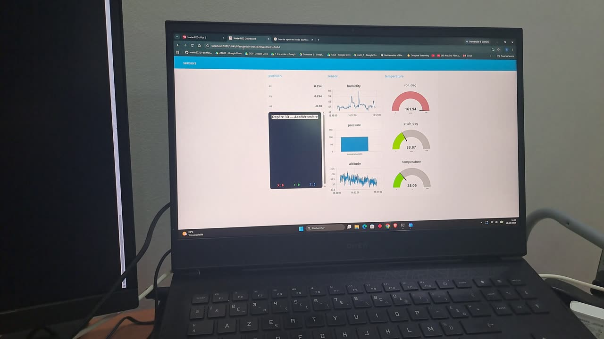
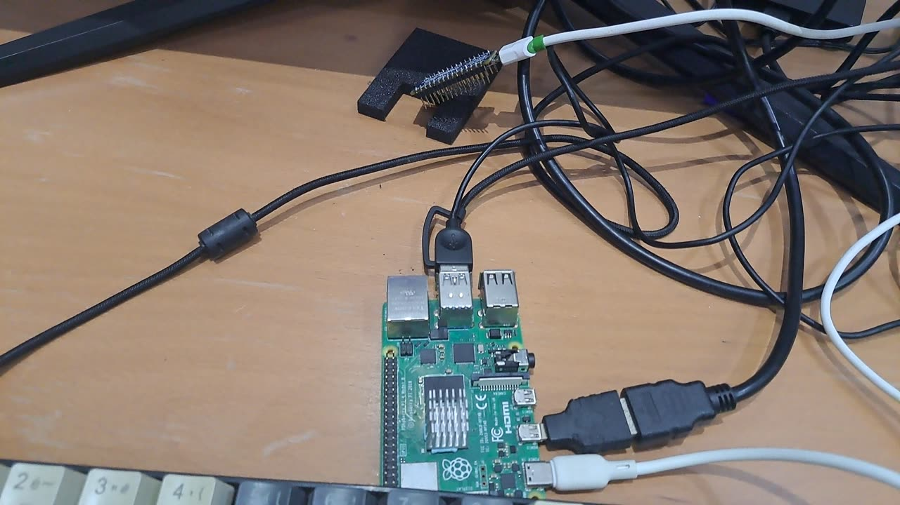
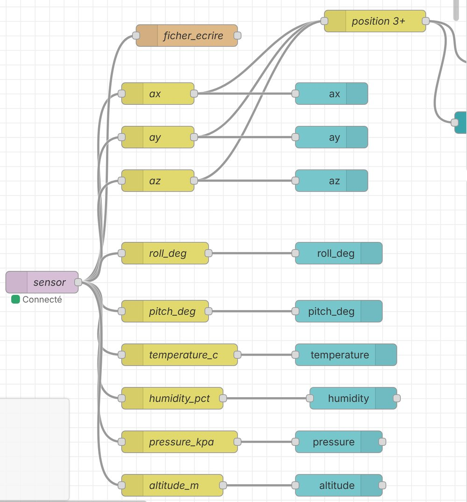

# 📡 Wireless Sensor Monitor over BLE and MQTT

> **An Arduino Nano 33 BLE Sense Rev2 streams motion and environment data over Bluetooth Low Energy to a Raspberry Pi, which republishes it on an MQTT broker. Node-RED shows it on a live dashboard and logs every reading.**

<p align="center">
  <a href="images/demo.mp4"></a>
</p>
<p align="center">
  <b>Live dashboard</b> · <a href="images/demo.mp4">▶ Watch the 19-second demo</a>
</p>

Built for the **Industrial Networks** course (Réseaux industriels), 3rd year Electrical Engineering, **ENIT**, 2026/2027.

---

## 📌 Overview

The Nano 33 BLE Sense has no Wi-Fi, so it cannot talk to an MQTT broker directly. The Raspberry Pi acts as a **gateway**: it receives each reading over BLE and publishes it to a local **Mosquitto** broker. Any client on the network can then subscribe, here a **Node-RED** dashboard running on a PC.

| What is measured | Sensor on the board | Fields |
|---|---|---|
| Acceleration and tilt | BMI270 (IMU) | `ax`, `ay`, `az` (g) · `roll_deg`, `pitch_deg` (°) |
| Temperature and humidity | HS300x | `temperature_c` (°C) · `humidity_pct` (%) |
| Pressure and altitude | LPS22HB | `pressure_kpa` (kPa) · `altitude_m` (m) |

---

## 🏗️ Architecture

```text
┌────────────────────┐  BLE notify   ┌──────────────────────┐  MQTT   ┌──────────────┐   sub   ┌───────────────────┐
│ Nano 33 BLE Sense  │ ────────────► │ Raspberry Pi         │ ──────► │ Mosquitto    │ ──────► │ Node-RED (PC)     │
│ Rev2               │  JSON, 1 Hz   │ gateway/bridge.py    │  :1883  │ on the Pi    │         │ dashboard + log   │
│ BMI270 · HS300x ·  │               │ bleak → paho-mqtt    │         │              │         │                   │
│ LPS22HB            │               │                      │         │              │         │                   │
└────────────────────┘               └──────────────────────┘         └──────────────┘         └───────────────────┘
```

<p align="center">
  
</p>
<p align="center"><b>Raspberry Pi gateway</b></p>

---

## 📨 Message format

| Item | Value |
|---|---|
| Broker | Mosquitto on the Raspberry Pi, port `1883` |
| Topic | `sensors/nano33` |
| Rate | 1 message per second |
| QoS | 0 (publisher) |
| Payload | one JSON object, 9 fields |

Example message:

```json
{"ax":-0.465,"ay":0.865,"az":-0.043,"roll_deg":92.83,"pitch_deg":28.22,
 "temperature_c":29.83,"humidity_pct":53.07,"pressure_kpa":101.657,"altitude_m":-27.64}
```

How the derived values are computed in the firmware:

```text
roll     = atan2(ay, az)                    [°]
pitch    = atan2(-ax, √(ay² + az²))         [°]
altitude = 44330 · (1 − (p / 101.325)^(1/5.255))   [m], p in kPa
```

Roll and pitch come from gravity alone, so they are only accurate when the board is not accelerating.

---

## 🔧 Components

### 1. Firmware: `firmware/nano33_ble_sensors/`

- Starts the BMI270, HS300x and LPS22HB sensors and stops with an error message if one fails.
- Advertises as **`Nano33Sensors`** with one GATT service and one string characteristic (read + notify, 180 bytes).
- Every 1000 ms: reads all sensors, computes roll, pitch and altitude, builds the JSON message and sends it as a BLE notification. The same line is printed on the serial monitor for debugging.

### 2. Gateway: `gateway/bridge.py`

- Scans for the board by name (`BleakScanner`), connects and subscribes to the characteristic.
- Decodes each notification, checks that it is valid JSON, and publishes it to `sensors/nano33`.
- Invalid messages are reported and skipped. If the BLE link drops, the script scans and reconnects on its own.

### 3. Dashboard: `node-red/flow.json`

<p align="center">
  
</p>
<p align="center"><b>Node-RED flow: one branch per field, plus the log writer</b></p>

| Dashboard group | Widgets |
|---|---|
| **position** | `ax`, `ay`, `az` values and a 3D view of the acceleration vector |
| **temperature** | gauges for roll (−180 to 180°), pitch (−90 to 90°) and temperature (0 to 50 °C) |
| **sensor** | charts for humidity, pressure and altitude (last hour) |

Every message is also appended to `nano33_log.ndjson`, one JSON object per line.

---

## 📈 Recorded data

[`data/nano33_log.ndjson`](data/nano33_log.ndjson) holds **4,199 readings** (about 70 minutes at 1 Hz) logged by Node-RED.

| Field | Min | Max | Mean |
|---|---:|---:|---:|
| Roll (°) | 48.6 | 130.7 | 86.7 |
| Pitch (°) | −4.7 | 39.9 | 30.3 |
| Temperature (°C) | 29.77 | 30.20 | 29.97 |
| Humidity (%) | 52.98 | 62.42 | 53.38 |
| Pressure (kPa) | 101.644 | 101.683 | 101.663 |

What the data shows:

- **Temperature reads about 30 °C**, higher than the room, because the board heats itself. It needs an offset before it can be used as room temperature.
- **Humidity jumps from 53 % to 62 %** when the sensor is touched or breathed on, then settles back.
- **Altitude is negative (about −28 m)** because it uses the standard sea-level pressure (101.325 kPa) as reference. It is useful as a relative value; for a true altitude, use the local sea-level pressure of the day.

---

## 🚀 Getting started

### Requirements

| Where | Install |
|---|---|
| **Arduino IDE** | Board package *Arduino Mbed OS Nano Boards*; libraries `ArduinoBLE`, `Arduino_BMI270_BMM150`, `Arduino_HS300x`, `Arduino_LPS22HB` |
| **Raspberry Pi** | `sudo apt install mosquitto mosquitto-clients` · `pip install -r gateway/requirements.txt` |
| **PC** | Node-RED and `node-red-dashboard` |

### 1. Flash the board

Open `firmware/nano33_ble_sensors/nano33_ble_sensors.ino`, select **Arduino Nano 33 BLE**, upload. The serial monitor (115200 baud) should print `BLE device: Nano33Sensors`.

### 2. Let Mosquitto accept connections from the PC

Since Mosquitto 2.0, the broker only listens on `localhost` by default. Add a file `/etc/mosquitto/conf.d/lan.conf` on the Pi:

```conf
listener 1883
allow_anonymous true
```

Then restart it:

```bash
sudo systemctl restart mosquitto
```

### 3. Start the gateway on the Pi

```bash
cd gateway
python3 bridge.py
```

Check that messages arrive:

```bash
mosquitto_sub -h localhost -t sensors/nano33
```

### 4. Import the dashboard on the PC

```bash
node-red
```

Open `http://localhost:1880`, **Menu → Import**, choose `node-red/flow.json`, then **Deploy**. Open the broker node (`nano33`) and set the IP address of your Raspberry Pi (the flow uses `192.168.1.117`). The dashboard is at `http://localhost:1880/ui`.

---

## 🛠️ Fixes made to the flow

| Problem | Fix |
|---|---|
| The `ax` node read `payload.ay`, so the dashboard showed Y as X | It now reads `payload.ax` |
| The 3D view stayed at `X: 0 Y: 0 Z: 0`: the join node keyed its object on `msg.topic`, which was the same for all three values | The 3D view now receives the full MQTT message, which already contains `ax`, `ay` and `az` |
| Roll and pitch gauges went from 0 to 100, but roll reached 131° and pitch went negative | Roll −180 to 180°, pitch −90 to 90°, temperature 0 to 50 °C |
| Charts were labelled `sensors/nano33` | Each branch sets `msg.topic` to its field name |
| The log file used an absolute Windows path | Relative path `nano33_log.ndjson`, created in the Node-RED folder |

---

## ⚠️ Known limitations and next steps

- [ ] **No security**: no password, no TLS. Fine on a lab network, not for a real installation. Next: Mosquitto users and passwords, then TLS on port 8883.
- [ ] **Fixed broker IP**: reserve the Pi's address in the router (DHCP reservation) or use `raspberrypi.local`.
- [ ] **QoS 0** on the publisher: a message can be lost if the broker restarts.
- [ ] The log file grows without limit. Next: store readings in InfluxDB and plot them with Grafana.
- [ ] Temperature offset calibration against a reference thermometer.

---

## 📁 Folder structure

```text
ble-mqtt-sensor-monitor/
├── README.md
├── firmware/
│   └── nano33_ble_sensors/
│       └── nano33_ble_sensors.ino   # BLE sensor node (Arduino)
├── gateway/
│   ├── bridge.py                    # BLE → MQTT bridge (Raspberry Pi)
│   └── requirements.txt
├── node-red/
│   └── flow.json                    # dashboard + logger (import into Node-RED)
├── data/
│   └── nano33_log.ndjson            # 4,199 logged readings
└── images/
    ├── dashboard.jpg
    ├── gateway-pi.jpg
    ├── node-red-flow.jpg
    └── demo.mp4
```

---

## 🛠️ Technologies

`MQTT` · `Mosquitto` · `Bluetooth Low Energy (GATT)` · `Node-RED` · `Python (bleak, paho-mqtt)` · `Arduino C++` · `Raspberry Pi` · `JSON`

## 📚 Skills developed

- Designing a sensor-to-dashboard data path across two protocols (BLE and MQTT)
- Publish/subscribe messaging: topics, QoS, broker configuration
- BLE GATT services and notifications on a microcontroller
- Asynchronous Python with automatic reconnection
- Node-RED flows and dashboards
- Reading sensor data critically (self-heating, reference pressure)

---

## Author

**Melek Chourabi** · Electrical Engineering, ENIT · [Portfolio](../README.md)
