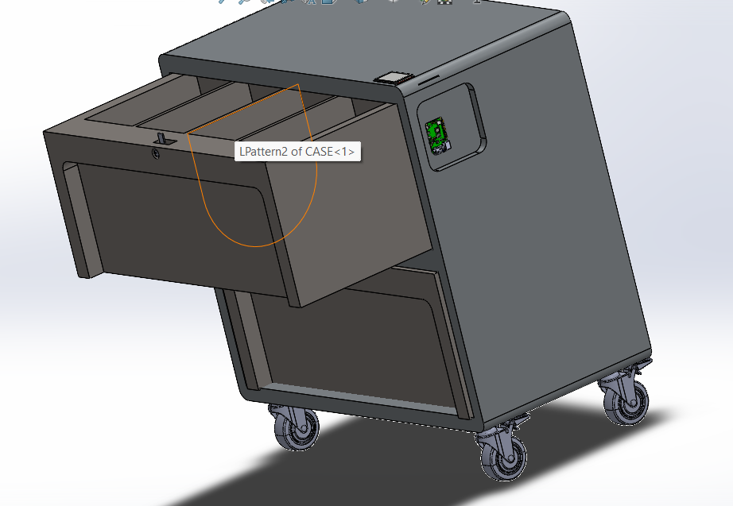
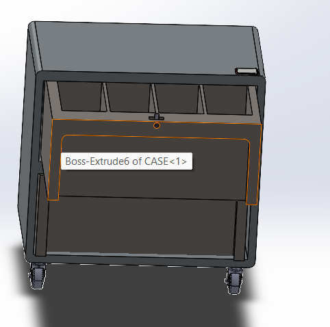
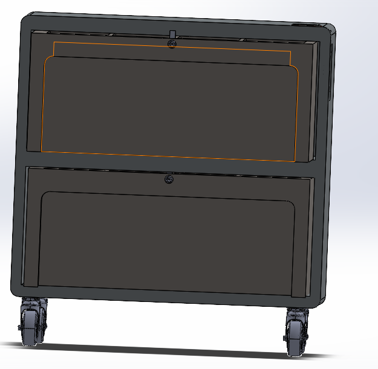
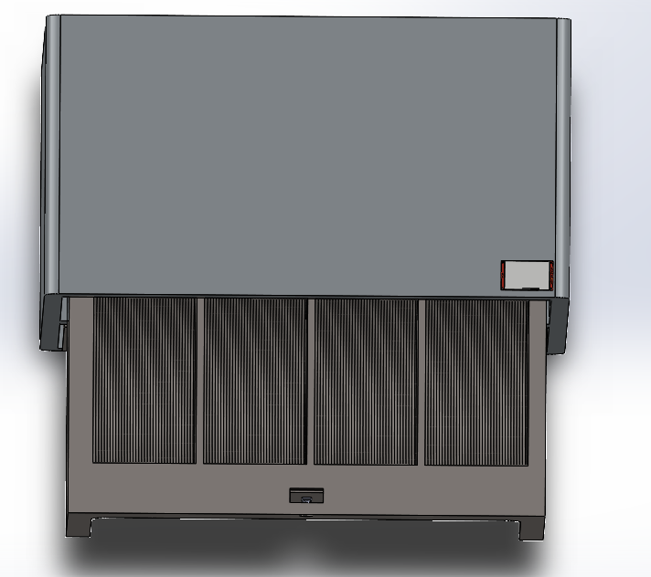

<h1 align="center">📦 Intelligent Inventory Cart: Object / Barcode Counter</h1>
<h3 align="center">Raspberry Pi 5 · YOLOv8 (ONNX) · Zebra barcode scanner · Tkinter</h3>

<p align="center">
  
  
  
  
  
</p>

<p align="center">
  
</p>

A logistics cart that stores component reels (*bobines*) in drawers, with a **verifier** on top: a camera counts the reels
that are visibly present, a barcode scanner counts the reels that were officially checked in or out, and the screen tells
you whether the two numbers agree. A reel that disappears (or is added without being logged) is caught **immediately**,
not at the next manual inventory.

| 📷 Objects (camera) | 🔫 Scanned (barcode) |
|---|---|
| Objects currently seen by the camera, detected on-device with YOLOv8n (ONNX Runtime, no PyTorch) | Number of *unique* articles scanned with a Zebra scanner |

The screen shows **🟢 MATCH** when both numbers are equal and **🔴 MISMATCH** (with the difference) otherwise. A barcode can
never be counted twice. **Add** and **Remove** are both driven by the scan itself: a mode switch on screen decides whether the next scan adds or
removes an article, so nothing but the scanner is needed in normal use.

---

## 🧩 How it works

```
 USB camera / Pi camera ─► detector.py (YOLOv8n ONNX, every N frames) ─┐
                                                                        ├─► inventory.py ─► app.py (Tkinter UI: counts, MATCH / MISMATCH, log)
 Zebra scanner (HID keyboard) ─► scanner.py (keystrokes → barcode) ─────┘
```

| Module | Role |
|---|---|
| `app.py` | Tkinter GUI: live video, the two counts, mode switch (add / remove), scanned list, reset |
| `detector.py` | Camera capture thread + ONNX inference + NMS; counts the objects of interest |
| `inventory.py` | Thread-safe state: set of scanned codes, camera count, `match` flag, event log |
| `scanner.py` | Rebuilds barcodes from fast keystrokes (tells a scanner from a human by typing speed; AZERTY digit fix) |
| `config.py` | Everything you may want to change: camera, model path, thresholds, class names, scanner timing |

`inventory.py` and `scanner.py` contain no hardware code, so they are unit-tested (see [Tests](#-tests)).

## 🛒 The cart (CAD)

The cart was designed in SolidWorks: a rolling case on casters with drawers that hold the reels.
The assembly file is in [`cad/cart_assembly.SLDASM`](cad/cart_assembly.SLDASM) (large file, about 15 MB).

<p align="center">
  
  
  
  
</p>

---

## 🧰 1. Hardware

- 🖥️ Raspberry Pi 5
- 🖼️ A screen (HDMI display, official touchscreen, etc.)
- 🎥 A USB webcam, **or** the official Raspberry Pi Camera Module (CSI)
- 🔫 A Zebra barcode scanner (DS22xx, LI36xx, DS3608, CS4070, ...) with a USB cable. These ship in **HID Keyboard Wedge** mode: they "type" the barcode and press Enter like a keyboard, so no driver is needed.

## ⚙️ 2. Install (on the Pi)

```bash
sudo apt update
sudo apt install -y python3-venv python3-pip libgl1

# Only for the Pi Camera Module (CSI) instead of a USB webcam:
sudo apt install -y python3-picamera2 --no-install-recommends

cd counter_app
python3 -m venv .venv --system-site-packages
source .venv/bin/activate
pip install -r requirements.txt
```

> ℹ️ The Pi only runs **ONNX Runtime**. `torch` / `ultralytics` are *not* installed on the Pi: the generic PyTorch wheel
> crashes there with "Instruction non permise" (SIGILL). Training and export are done on a normal PC (next section).

## 🧠 3. The detection model (ONNX)

`config.py` expects an ONNX file (`MODEL_PATH = "yolov8n.onnx"`), placed in `counter_app/`.

**Export a generic COCO model on your PC** (to test the pipeline):

```bash
pip install ultralytics
yolo export model=yolov8n.pt format=onnx          # produces yolov8n.onnx → copy it to the Pi
```

**Important:** the configuration counts only the class `"bobine"` (`CLASSES_OF_INTEREST = ["bobine"]`). The generic COCO model has no
such class, so the object count stays at 0 until you train your own reel detector:

1. Label photos of the reels (one class, `bobine`) with a tool such as Roboflow or CVAT.
2. Train on your PC: `yolo detect train data=bobines.yaml model=yolov8n.pt epochs=100 imgsz=640`
3. Export to ONNX (command above) and copy the `.onnx` file to the Pi.
4. In `config.py`: `MODEL_PATH = "<your file>.onnx"` and `CLASS_NAMES = {0: "bobine"}`.

## 🎛️ 4. Configure

Open `counter_app/config.py`:

| Setting | What it does |
|---|---|
| `SCANNER_KEYBOARD_IS_AZERTY` | Digit fix for AZERTY keyboards (default `True`) |
| `FULLSCREEN` | Start in fullscreen (`Esc` leaves it) |
| `CAMERA_SOURCE` | `0` for the first USB webcam, or `"picamera"` for the Pi Camera Module |
| `MODEL_PATH`, `CLASS_NAMES` | The ONNX model and the names of its classes (must match the model) |
| `CLASSES_OF_INTEREST` | Classes to count; `[]` counts every detected object |
| `CONFIDENCE_THRESHOLD`, `NMS_IOU_THRESHOLD` | Detection filtering |
| `DETECT_EVERY_N_FRAMES` | Raise (3–4) if the video is slow, lower for more responsive counting |

## 🔫 5. Set up the Zebra scanner

Most Zebra scanners work out of the box in HID mode. If scans are not recognised:

1. Open the **Product Reference Guide** of your scanner model (Zebra support site).
2. Scan the setup barcode **"USB HID Keyboard"** if it is not already selected.
3. Scan **"Suffix = Enter"** / **"Add CR Suffix"** so each scan ends with Return: the app uses it to know a barcode is complete.

If your system keyboard is **AZERTY**, the scanner "types" punctuation (`&é"'(`) instead of digits. The fix is on by default
(`SCANNER_KEYBOARD_IS_AZERTY = True` in `config.py`); set it to `False` on a US layout.

## ▶️ 6. Run

```bash
source .venv/bin/activate
python3 app.py
```

- 🖱️ Click into the window once so it has keyboard focus, then scan.
- 🔀 **Add mode / Remove mode** chooses what the next scan does.
- 🔄 **Reset all** clears every scanned article (the camera count always reflects what is in view).
- ⎋ `Esc` leaves fullscreen.

## 🚀 7. Optional: start at boot (kiosk mode)

```bash
sudo tee /etc/systemd/system/counter-app.service > /dev/null <<'EOF'
[Unit]
Description=Object/Barcode Counter
After=graphical.target

[Service]
Environment=DISPLAY=:0
User=pi
WorkingDirectory=/home/pi/counter_app
ExecStart=/home/pi/counter_app/.venv/bin/python3 /home/pi/counter_app/app.py
Restart=on-failure

[Install]
WantedBy=graphical.target
EOF

sudo systemctl enable --now counter-app.service
```

> 💡 Adjust the paths and the user name if you did not use the default `pi` user or this location.

## ⚡ 8. Performance notes (Pi 5)

- YOLOv8n on the Pi 5 CPU runs at a few frames per second: enough for counting objects sitting on a table or in a drawer.
- Increase `DETECT_EVERY_N_FRAMES` first; the video preview still updates every frame.

## 🧪 Tests

The decision logic (inventory state and barcode assembly) is tested without any hardware:

```bash
cd counter_app
pip install pytest
python -m pytest -q tests
```

## 📁 Project structure

```
inventory-cart-rpi-yolo/
├── README.md
├── counter_app/
│   ├── app.py              # Tkinter GUI
│   ├── detector.py         # camera + ONNX YOLOv8n thread
│   ├── inventory.py        # thread-safe state
│   ├── scanner.py          # keystrokes → barcodes
│   ├── config.py           # settings
│   ├── requirements.txt
│   └── tests/              # pytest unit tests
├── cad/cart_assembly.SLDASM  # SolidWorks assembly of the cart
└── images/                   # CAD screenshots
```
