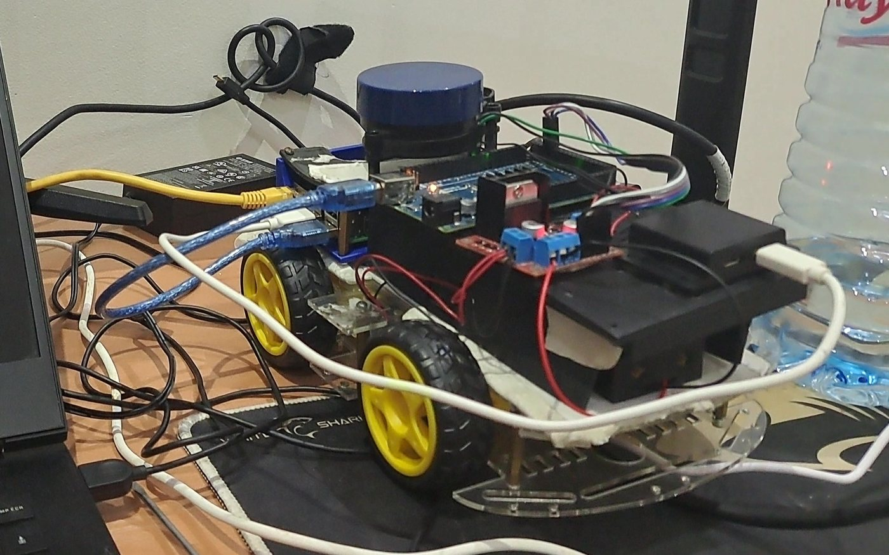
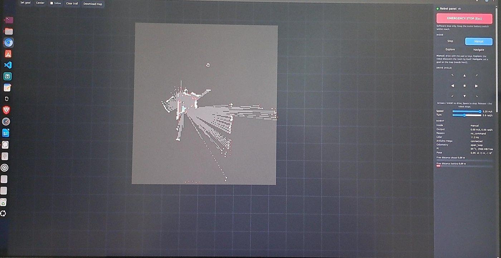
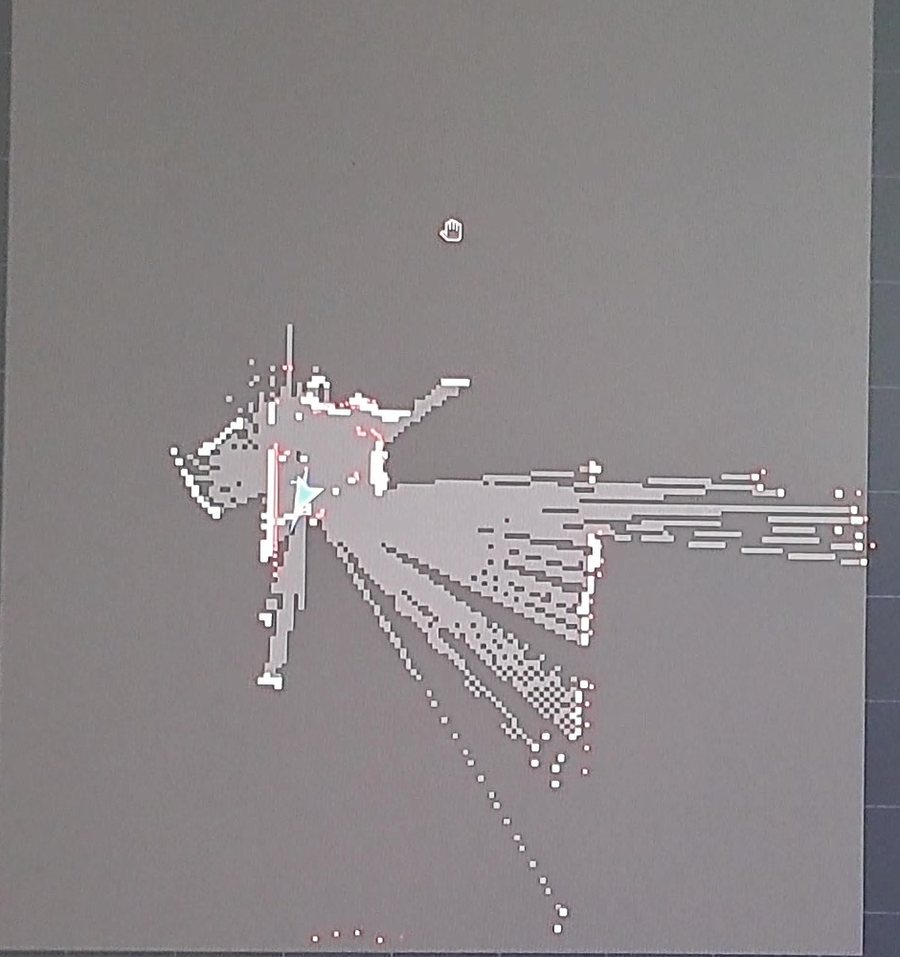
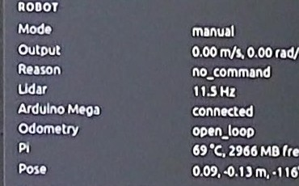

# 🤖 Autonomous Mobile Robot with Lidar SLAM (ROS 2)

> **A skid-steer robot driven from a web panel on a PC while it maps the room with a 2D lidar. It can also explore on its own or drive to a goal clicked on the map. Every command goes through one safety layer before it reaches the motors.**

<p align="center">
  
</p>
<p align="center"><b>The robot: Raspberry Pi 5 · Arduino Mega 2560 · H-bridge · 4 DC motors · YDLIDAR X2</b></p>

Engineering project (BE), 3rd year Electrical Engineering, **ENIT**, 2026/2027.
Full engineering report: [`docs/engineering-report.pdf`](docs/engineering-report.pdf) (21 pages: architecture, code walkthrough, tests).

---

## 📌 Overview

The robot has three jobs:

1. **Be driven from a PC** while the operator watches the live map and lidar points in a browser.
2. **Build a map of the room** with SLAM (slam_toolbox).
3. **Move on its own**, either by reactive exploration or by Nav2 navigation to a goal clicked on the map.

It is designed around a small, low-cost robot with **no wheel encoders**, which is the main constraint on map quality.

<p align="center">
  
</p>
<p align="center"><b>Web panel on the PC, connected to the real robot</b></p>

<table>
  <tr>
    <td width="60%"></td>
    <td width="40%" valign="top"><br><sub>Live status from the robot: lidar at <b>11.5 Hz</b>, Arduino Mega connected, open-loop odometry, Pi at 69 °C.</sub></td>
  </tr>
  <tr>
    <td colspan="2" align="center"><sub>Left: occupancy map built live by slam_toolbox, with the current lidar scan in red.</sub></td>
  </tr>
</table>

---

## 🏗️ Architecture

```text
 PC (Docker, ROS 2 Jazzy)                    Raspberry Pi 5 (Ubuntu 24.04, ROS 2 Jazzy)          hardware
 ┌────────────────────────┐   RJ45 / Wi-Fi    ┌──────────────────────────────────────────┐
 │ web panel (browser):   │◄─────────────────►│ ydlidar driver ─► /scan ─► scan_filter ──┼─► slam_toolbox ─► /map
 │  map, lidar, drive,    │   ROS 2 / DDS     │                              │           │
 │  modes, e-stop, goal   │   domain 42       │ PC panel (manual) ─┐         ▼           │
 └────────────────────────┘                   │ explorer (explore) ┼─► cmd_mux ─► base_node ─► USB ─► Arduino Mega
                                              │ Nav2 (nav)        ─┘  (mode, e-stop,     │            │ PWM
                                              │                        obstacle stop)    │            ▼
                                              │ health, map_autosave                     │      H-bridge ─► motors
                                              └──────────────────────────────────────────┘
```

| Layer | Contents | Role |
|---|---|---|
| Operator (PC) | Web panel, optional RViz | Shows the map, sends intent (mode, keys, goal). Never talks to the motors directly. |
| Autonomy (Pi) | slam_toolbox, Nav2, explorer | Decides *what* to do: map, plan, wander. |
| Safety (Pi) | scan_filter, cmd_mux, health | Decides what is *allowed*: filters the lidar, limits commands, watches for failures. |
| Base (Pi) | base_node, kinematics, motors | Turns velocity commands into wheel PWM and odometry. |
| Firmware (Mega) | `mega_motor_driver.ino` | Drives the pins, 400 ms watchdog. |

### Design principles

- **Separate thinking from driving.** The Pi runs all of ROS 2. The Mega only turns `M <left> <right>` text lines into PWM; if the Pi crashes, the Mega can only stop.
- **One writer to the motors.** Panel, explorer and Nav2 all want to move the robot. Only the source of the current mode is listened to, and everything passes through one safety node.
- **Fail safe.** No command for 0.5 s, no lidar for 1 s, no serial line for 0.4 s, an e-stop or a lost USB cable: all end with the motors at zero.
- **Pure logic separated from ROS.** The decisions (safety rules, kinematics, scan filter, explorer) are plain Python, so they are unit-tested without a robot.

---

## 🛡️ Safety layer (`cmd_mux`)

The rules are applied in this order, 20 times per second:

1. E-stop latched → stop
2. Mode is `stop` → stop
3. Take the command of the source that matches the mode (`manual`, `explore` or `nav`)
4. Source silent for more than 0.5 s → stop (dead-man)
5. Clamp to 0.20 m/s and 1.2 rad/s
6. Lidar silent for more than 1 s → stop (blind)
7. Obstacle in the body corridor → speed scaled linearly from 0.45 m down to a full stop at 0.10 m, ahead or behind

**Worst-case stopping distance** after the operator lets go, at 0.20 m/s: 0.10 m during the dead-man delay plus 0.033 m during the deceleration ramp (0.6 m/s²), so about **13 cm**.

---

## 🗺️ Mapping without wheel encoders

The odometry is dead-reckoned from the commanded speeds, so it cannot see wheel slip. The map therefore relies on scan matching:

| Choice | Value | Why |
|---|---|---|
| Lidar filter | invalid and isolated beams removed | crisper walls, no phantom obstacles |
| Map resolution | 0.05 m | good detail for a room |
| Max laser range | 7.5 m | the X2 is noisy near its 8 m limit |
| Loop closing | on | the whole map is corrected when the robot returns to a known place |
| Variance penalties | 0.6 / 0.8 | trust the scan matcher more than the odometry |
| Autosave | every 180 s, last 10 kept | a power cut loses at most 3 minutes of mapping |

---

## 🧪 Tests

`robot_ws/run_all_tests.sh` runs without ROS, Arduino or lidar:

| Test | What it proves | Result |
|---|---|---|
| Firmware (compiled on a PC) | Mega command parsing and watchdog | ✅ passed |
| Serial link ↔ simulated Mega | Pi–Mega protocol, reconnection | ✅ passed |
| Kinematics | differential-drive maths, speed → PWM | ✅ 10 tests passed |
| Safety layer | modes, e-stop, dead-man, blind lidar, obstacle stop, clamps | ✅ passed |
| Robot + safety + explorer in a simulated room | teleop into walls and 3 exploration runs | ✅ 0 collisions |
| Explorer alone, 5 min simulated | coverage | ✅ 0 collisions, 90 % of the room seen |
| Web panel in a real browser | drawing, buttons, keys, token and Host checks | ✅ passed |

On the real robot, the lidar, the Mega link, the web panel and live mapping run (photos above). Still to do on the hardware: motor calibration, Nav2 click-to-go tuning, and mapping a full room with loop closure.

---

## 🚀 Running it

Full instructions: [`robot_ws/README.md`](robot_ws/README.md).

```bash
# Raspberry Pi (once)
cd robot_ws && ./setup_pi.sh

# Raspberry Pi (every session)
./run_robot.sh                 # starts in manual mode; the robot does not move by itself

# PC (only Docker needed)
./pc/panel.sh                  # then open http://localhost:8080
```

---

## ⚠️ Limitations and next steps

- [ ] **Not a certified safety system**: the e-stop is software. A physical switch on the motor battery is required.
- [ ] **Wheel encoders**: the firmware and ROS side already support them; the single best upgrade for map quality.
- [ ] **IMU** (MPU-6050 / BNO055) fused with `robot_localization` for a reliable heading.
- [ ] **Frontier exploration** instead of the reactive wanderer, for full room coverage.
- [ ] **Closed-loop PID** speed control on the Mega.

---

## 📁 Folder structure

```text
ros2-lidar-robot/
├── README.md
├── docs/engineering-report.pdf
├── images/
└── robot_ws/
    ├── README.md                 # operating manual
    ├── run_robot.sh  setup_pi.sh  check_system.sh  run_all_tests.sh
    ├── firmware/mega_motor_driver/   # Arduino Mega sketch + host tests
    ├── src/
    │   ├── robot_base/           # cmd_mux, scan_filter, explore, base_node, health, map_autosave
    │   ├── robot_lidar/          # lidar launch and config
    │   ├── ydlidar_ros2_driver/  # YDLIDAR driver (third party, see its LICENSE)
    │   └── robot_description/    # URDF, simulation, offline tools
    ├── pc/                       # web panel, RViz, teleop, e-stop scripts (Docker)
    └── pc_viewer/                # lidar viewer without ROS
```

---

## 🛠️ Technologies

`ROS 2 Jazzy` · `slam_toolbox` · `Nav2` · `Python` · `C++` · `Arduino` · `Docker` · `Raspberry Pi 5` · `YDLIDAR X2`

## 📚 Skills developed

- ROS 2 system design: nodes, topics, QoS, TF tree, lifecycle nodes, launch files
- SLAM tuning for a robot without encoders
- Safety design for a mobile robot: command arbitration, watchdogs, obstacle stop
- Differential-drive kinematics and odometry
- Serial protocol and firmware for real-time motor control
- Networking two machines with different ROS distributions (Docker, DDS)
- Testing robot software offline with simulation and stand-ins

---

## Author

**Melek Chourabi** · Electrical Engineering, ENIT · [Portfolio](../README.md)
