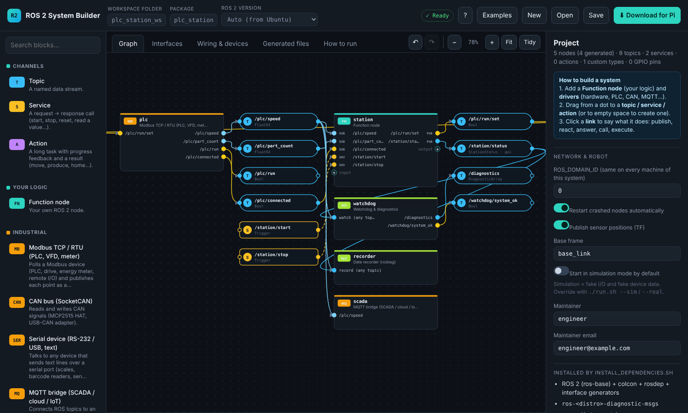
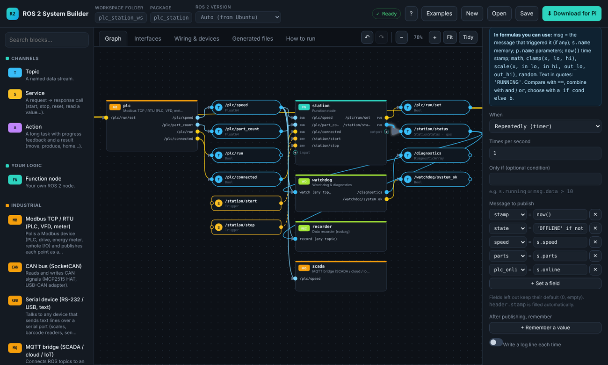
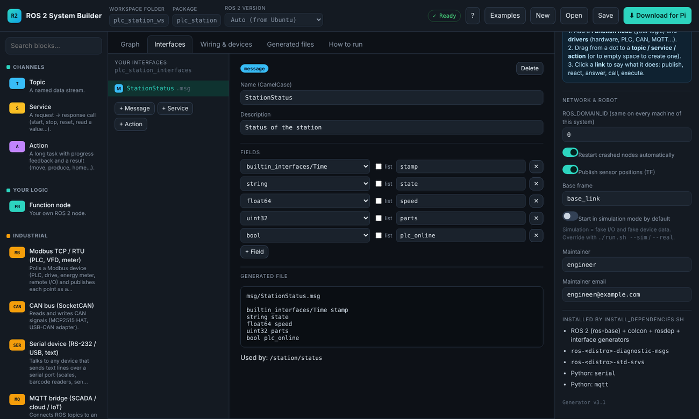
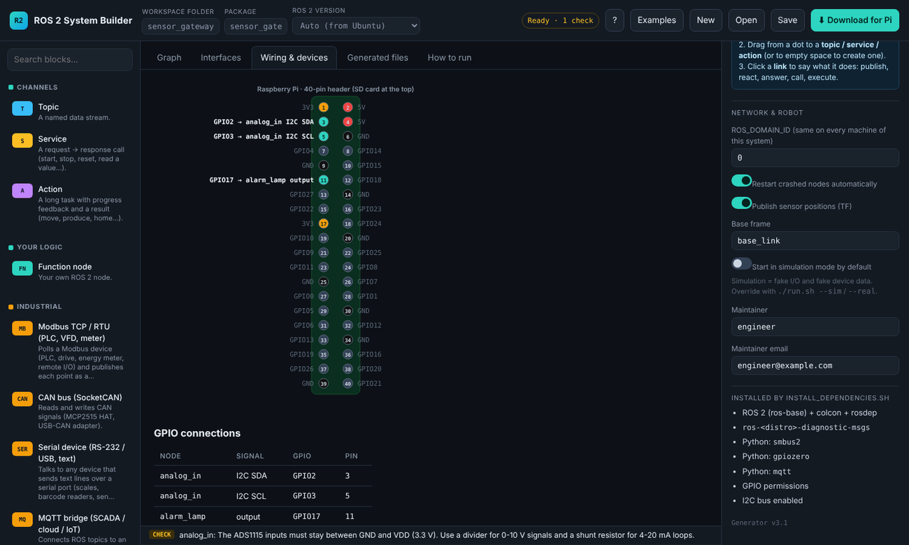
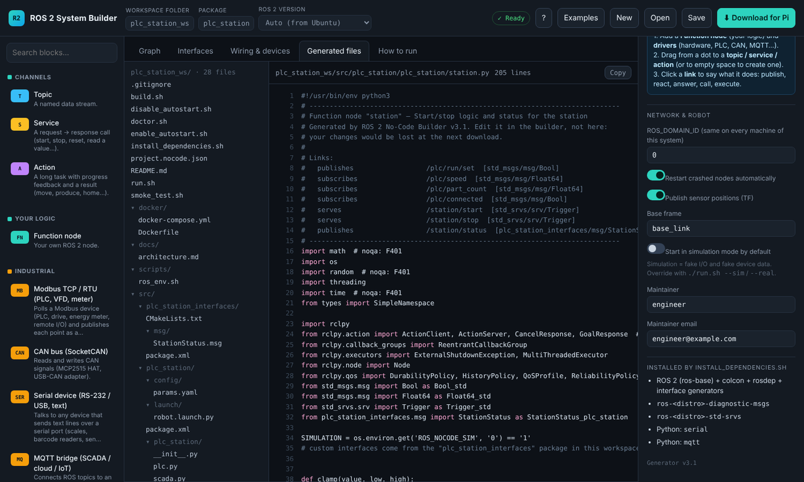

# 🧩 ROS 2 System Builder — no-code ROS 2 for Raspberry Pi

> **A graphical tool to design a complete ROS 2 system — custom logic, hardware drivers, PLCs and networks — and download a workspace for a Raspberry Pi that installs its dependencies, builds, tests and runs itself.**

<p align="center">
  
  
  
  
</p>

> [!WARNING]
> **Work in progress.** The generated code compiles and runs on real ROS 2 Jazzy, but it has **not yet been validated on
> Raspberry Pi hardware** (GPIO, I²C, CAN, motors). Features and the project format may still change.

**Source code, tool and full documentation:** 👉 [github.com/melek2232/ros2-system-builder](https://github.com/melek2232/ros2-system-builder)
· Personal project, November 2026.

<p align="center">
  
</p>
<p align="center"><b>Example "PLC station": a Modbus TCP PLC, a station controller with start/stop services and a custom status message, a watchdog, a data recorder and an MQTT link to SCADA</b></p>

---

## 📌 Overview

Before the first message is exchanged, running ROS 2 on a Raspberry Pi for a real application takes packages, launch and
parameter files, drivers, install scripts, udev rules and systemd services. This tool generates all of it from a diagram:

1. **Draw the system.** Nodes do the work, channels carry the data:
   - **Nodes:** your own logic in Function nodes, or drivers.
   - **Channels:** topics, services and actions.
2. **Link** a node to a channel. The direction of the link sets its role: node → topic publishes, topic → node subscribes; the same goes for calling / serving a service and sending / executing action goals.
3. **Describe the logic** of each link with simple formulas (no programming).
4. **Download** a ZIP, then on the Pi: `./install_dependencies.sh` → `./build.sh` → `./smoke_test.sh` → `./run.sh`.

<table>
  <tr>
    <td width="50%"></td>
    <td width="50%"></td>
  </tr>
  <tr>
    <td align="center"><sub>Link editor: the status message is filled with formulas such as <code>'RUNNING' if s.running else 'STOPPED'</code></sub></td>
    <td align="center"><sub>Custom <code>.msg</code> / <code>.srv</code> / <code>.action</code> types, generated as a real ROS 2 interface package</sub></td>
  </tr>
  <tr>
    <td width="50%"></td>
    <td width="50%"></td>
  </tr>
  <tr>
    <td align="center"><sub>Wiring view of the 40-pin header, with checks (pin conflicts, voltage limits)</sub></td>
    <td align="center"><sub>Every file of the workspace can be read before downloading</sub></td>
  </tr>
</table>

---

## ⚙️ What it can build

| Area | Blocks |
|---|---|
| **Your logic** | Function node: memory variables, runtime parameters, conditions, chained actions; publish / subscribe, service server / client, action server / client |
| **Industrial** | Modbus TCP / RTU (dependency-free master), CAN bus (SocketCAN, MCP2515 HAT), serial text devices, MQTT bridge, ADS1115 analog inputs (4-20 mA / 0-10 V) |
| **Sensors** | HC-SR04, MPU-6050, USB camera, RPLIDAR, YDLIDAR, digital inputs, CPU temperature |
| **Actuators** | Relay / LED, PWM, servo, L298N differential drive, wheels through an Arduino (sketch generated) |
| **Monitoring** | Watchdog publishing standard `/diagnostics`, rosbag recorder |

The generated workspace also contains:
- `doctor.sh`: checks power, permissions, and whether the PLC, broker and CAN bus can be reached;
- `smoke_test.sh`: starts everything in simulation and checks every node;
- a systemd autostart service, Docker files, and `docs/architecture.md` (Mermaid diagram of every channel, type and QoS).

---

## 🏗️ How it works

```text
 Browser (single HTML file, works offline)                       Raspberry Pi (Ubuntu + ROS 2)
 ┌──────────────────────────────────────────────┐   ZIP          ┌──────────────────────────────────────────┐
 │ editor ──► project model (nodes, channels,    │  ───────────►  │ install_dependencies.sh  (ROS 2, libs,   │
 │            links, interfaces)                 │                │                          permissions)    │
 │        ──► validator (types, QoS, GPIO, names)│                │ build.sh  ─► colcon: <pkg> + interfaces  │
 │        ──► generator: Python nodes, launch,   │                │ smoke_test.sh / doctor.sh                │
 │            params.yaml, rosidl package,       │                │ run.sh ─► ros2 launch (respawn, TF)      │
 │            shell scripts, systemd, Docker     │                └──────────────────────────────────────────┘
 └──────────────────────────────────────────────┘
```

A few design points:
- **QoS reconciliation.** ROS 2 silently drops messages when publisher and subscriber QoS are incompatible. The generator therefore adjusts each Function-node endpoint to stay compatible with the drivers on the same topic, and reports every adjustment.
- **Thread safety.** Function nodes run on a multi-threaded executor, so long actions don't block the rest. One re-entrant lock keeps their memory consistent. Action cancel reacts within 50 ms.
- **Safe scripts.** Every user-provided device name, host and path is validated and shell-quoted before it reaches a generated script.

---

## ✅ Testing

| Area | Result |
|---|---|
| Generated workspaces compile with `colcon` + `rosidl` (ROS 2 Jazzy) | ✅ all examples |
| Pub/sub, services, actions (feedback, cancel, one goal at a time), runtime parameters | ✅ on real ROS 2 |
| Modbus TCP read (16/32-bit, scaling) and coil write | ✅ against a pymodbus server |
| MQTT in both directions | ✅ against Mosquitto |
| Serial device | ✅ virtual serial port |
| CAN encoding / decoding | ⚠️ unit-tested only |
| GPIO, I²C, motors on a real Raspberry Pi | ⏳ next step |
| Generated code quality | ✅ flake8 and shellcheck clean |

---

## 🧭 Next steps

- Hardware validation on Raspberry Pi 4 / 5 (GPIO, I²C, CAN, Modbus RTU)
- A "Code node" to write a link's behaviour in Python inside the editor
- OPC UA, Nav2 / SLAM blocks, lifecycle nodes, multi-machine projects

<sub>Tech: JavaScript (no framework) · ROS 2 (rclpy, launch, rosidl) · Python · Bash · systemd · Docker · Playwright tests. Built with the help of Claude (Anthropic).</sub>
